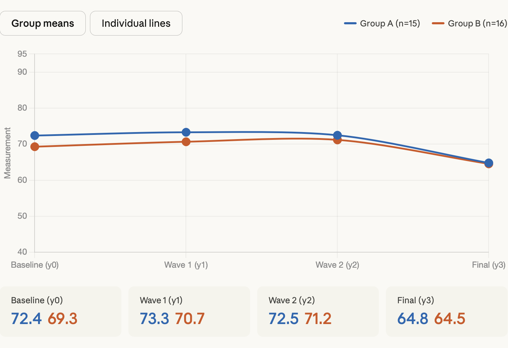
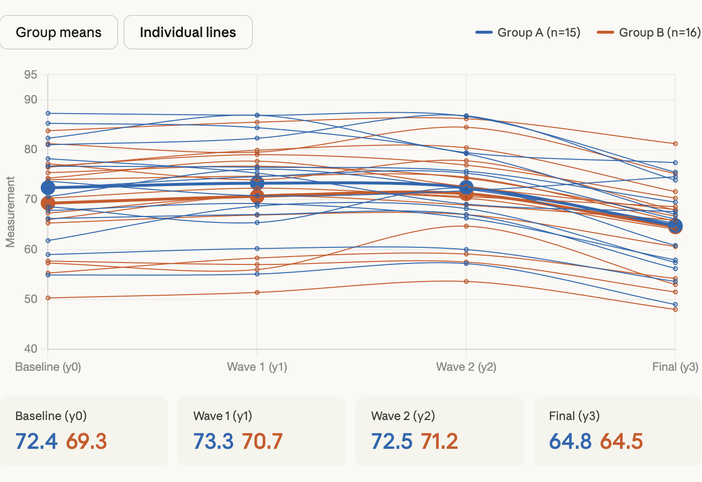

```{r}
#| label: setupPackages

# Load packages ----
library(tidyverse)
library(knitr)
library(kableExtra)
```


# Diamonds Tables of Statistics {#sec-diamonds}

```{r}
#| label: loadDiamonds

# Load the diamonds data ----
data(diamonds)
```

```{r}
#| label: wrangleDiamonds

# Remove impossible diamonds and keep needed attributes ----
Diamonds_Clean <- diamonds |>
  filter(x > 0, y > 0, z > 0) |> # Keep diamonds with no zero dimension
  select(clarity, x, y, z) # Keep clarity and the three dimensions

# Find the descriptive statistics for each dimension and clarity ----
Diamonds_Stats <- Diamonds_Clean |>
  pivot_longer( # Stack length, width, and depth into one column
    cols = x:z,
    names_to = "dimension",
    values_to = "value"
  ) |>
  group_by(dimension, clarity) |> # One group for each dimension and clarity
  summarize( # Calculate the statistics for every group
    Count = n(),
    Min = min(value),
    Quint1 = quantile(value, probs = 0.2),
    Quint2 = quantile(value, probs = 0.4),
    Median = median(value),
    Quint3 = quantile(value, probs = 0.6),
    Quint4 = quantile(value, probs = 0.8),
    Max = max(value),
    Mean = mean(value),
    SD = sd(value),
    .groups = "drop"
  ) |>
  arrange(dimension, clarity) # Put the rows in order

# Column names for the three tables ----
diamondCols <- c("Clarity", "Freq.", "0%-tile", "20%-tile", "40%-tile",
                 "Median", "60%-tile", "80%-tile", "100%-tile", "SAM", "SASD")

```

The diamonds data set records the price and physical attributes of 53,940
diamonds. Before building I removed the 20 diamonds that had a
length, width, or depth of zero. That left 53,920 diamonds. Each of the following tables breaks one physical
dimension down by *clarity*, which grades the quality of a diamond agianst it's flaws. The rows run from the lowest grade, I1
(included), up to the highest, IF (internally flawless). All measurements are in
millimeters.

## Length {#sec-diamondsLength}

```{r}
#| label: tbl-diamondsLength
#| tbl-cap: "Summary Statistics on Diamond Length (mm) by Clarity"
#| tbl-pos: H
#| html-table-processing: none

# Make the diamond length table ----
Diamonds_Stats |>
  filter(dimension == "x") |> # Keep the length statistics
  select(-dimension) |> # Drop the dimension label
  kable(
    digits = 2,
    col.names = diamondCols,
    format.args = list(big.mark = ","),
    align = "lcccccccccc"
  ) |>
  kable_classic(font_size = 10)

```

@tbl-diamondsLength shows a pattern: the clearer the diamond, the shorter
it tends to be. The median length falls from 6.64 mm for I1 diamonds to 4.57 mm
for IF diamonds, and almost all quintiles follow the same downward path. 
One possible reason is how diamonds form and get cut. Larger
rough stones are more likely to contain problems, while a small stone has less room for an issue. 
The frequencies also show that the middle grades (SI1 and VS2) make up the bulk of
the data, while I1 and IF are the rarest. The SASD values for VVS1 and IF are
the smallest which tells us those top grades are not only smaller on average
but also more uniform.

## Width {#sec-diamondsWidth}

```{r}
#| label: tbl-diamondsWidth
#| tbl-cap: "Summary Statistics on Diamond Width (mm) by Clarity"
#| tbl-pos: H
#| html-table-processing: none

# Make the diamond width table ----
Diamonds_Stats |>
  filter(dimension == "y") |> # Keep the width statistics
  select(-dimension) |> # Drop the dimension label
  kable(
    digits = 2,
    col.names = diamondCols,
    format.args = list(big.mark = ","),
    align = "lcccccccccc"
  ) |>
  kable_classic(font_size = 10)

```

The widths in @tbl-diamondsWidth are almost identical to the lengths in
@tbl-diamondsLength for every clarity grade. This makes sense if
most of these are round cut stones since a round stone is as wide as it is
long. The same downward trend appears, with the median width falling from 6.61
mm (I1) to 4.59 mm (IF). The one place the two tables disagree is the 100%-tile
column. The largest SI2 diamond is listed as 58.90 mm wide and the largest VS1
diamond as 31.80 mm wide when no other diamond in the data is wider than 11
mm. These are almost certainly data entry errors. Since the SI2 and VS1 groups
are so large the two values barely effect the the SAM. It does have an effect on 
SASD. The median and quintiles are not affected at all, which makes them the
most reliable summary of a typical diamond here.

## Depth {#sec-diamondsDepth}

```{r}
#| label: tbl-diamondsDepth
#| tbl-cap: "Summary Statistics on Diamond Depth (mm) by Clarity"
#| tbl-pos: H
#| html-table-processing: none

# Make the diamond depth table ----
Diamonds_Stats |>
  filter(dimension == "z") |> # Keep the depth statistics
  select(-dimension) |> # Drop the dimension label
  kable(
    digits = 2,
    col.names = diamondCols,
    format.args = list(big.mark = ","),
    align = "lcccccccccc"
  ) |>
  kable_classic(font_size = 10)

```

@tbl-diamondsDepth shows that depth follows the same pattern as length and width.
The median depth drops from 4.11 mm for I1 diamonds to 2.80 mm for IF
diamonds. Looking at the medians across the three tables shows a diamond's depth is
about 61% to 62% of its width for every clarity grade. Depth also has the smallest spread of the
three dimensions with the SASD values between 0.52 and 0.72 mm. Two values stand
out: a VS1 diamond listed as 31.80 mm deep, and an SI1 diamond
only 1.07 mm deep. The three tables suggest that buyers looking
at the clearest diamonds should expect smaller stones.

# Big 10 Academic Alliance: Love Data Week {#sec-btaa}

```{r}
#| label: loadGames

# Load the NCAA women's basketball team box scores ----
Games_Raw <- read_csv(file = "team_box.csv") # One row per team per game

```

```{r}
#| label: wrangleGames

# Clean the games ----
Games_Clean <- Games_Raw |>
  filter(season_type == 2) |> # Keep regular season games
  filter(season >= 2017) |> # Keep the seasons with complete data
  filter(team_score != opponent_team_score) |> # Drop games with tied scores
  select( # Keep only the columns we need
    season, team_id, team_display_name, team_winner,
    three_point_field_goals_attempted
  ) |>
  rename(
    teamId = team_id,
    team = team_display_name,
    win = team_winner,
    threePointAttempts = three_point_field_goals_attempted
  ) # Use shorter column names

# Build the team seasons ----
Team_Seasons <- Games_Clean |>
  group_by(season, teamId, team) |> # One group for each team in each season
  summarise( # Find the stats for each group
    games = n(),
    winPct = mean(win) * 100,
    avgThreePointAttempts = mean(threePointAttempts),
    .groups = "drop"
  ) |>
  filter(games >= 15) |> # Drop team seasons with few games
  arrange(season, team) # Put the rows in order

```

```{r}
#| label: preparePlotSeasons

# Prepare the plot data ----
Plot_Seasons <- Team_Seasons |>
  filter(season %in% c(2017, 2022, 2026)) |> # Keep first, middle, and latest
  mutate(season = factor(season)) # Treat season as a category, not a number

```

For the Big Ten Academic Alliance (BTAA) Data Viz Championship I used the
official NCAA women's basketball team box scores. Each row is one team's
performance in one game. I kept regular season games from 2017 through 2026, and
dropped the few games that ended in a tie. I then summarized the data so that
each case is one team in one season. For each team season I found the team's
win percentage and its average number of three-point attempts per game. I only
kept team seasons with at least 15 games so that a team with a handful of games
could not post a misleading win percentage.

```{r}
#| label: fig-btaaPlot
#| fig-cap: "Win Percentage by Three-Point Attempts in NCAA Women's Basketball"
#| fig-pos: H
#| fig-height: 3.5
#| fig-alt: "Three scatterplots of NCAA women's basketball team win percentage versus
#|   three-point attempts per game in 2017, 2022, and 2026, each with an
#|   upward-sloping trend line."

# Make the BTAA plot ----
ggplot(
  data = Plot_Seasons,
  mapping = aes(
    x = avgThreePointAttempts,
    y = winPct,
    color = season,
    shape = season
  )
) + # Each point is one team in one season
  geom_point(alpha = 0.5) + # See through overlapping points
  geom_smooth( # Improvement: Add a trend line for each season
    method = "lm",
    formula = y ~ x,
    se = FALSE,
    linewidth = 0.8
  ) +
  facet_wrap(facets = ~season) + # One panel for each season
  scale_color_manual(
    values = c("#1E407C", "#BC204B", "#3EA39E")
  ) + # Colors that are easy to tell apart
  labs(
    x = "Average Three-Point Attempts per Game",
    y = "Win Percentage (%)",
    color = "Season",
    shape = "Season",
    caption = "Source: ESPN team box scores from {wehoop} (SportsDataverse)"
  ) + 
  theme_bw() + # Plain background
  theme(legend.position = "none") # Panel titles already show the season

```

@fig-btaaPlot shows that in every season the teams form a wide vertical cloud
with a slight upward tilt. The trend lines show that teams that attempt more
three-pointers tend to win slightly more, but the relationship is weak.
There are plenty of teams that shoot few threes and still win most of their
games, and teams that shoot many threes and lose most of theirs. In 2017 and
2022 each extra three-point attempt per game went with roughly a 0.6 to 0.7
percentage point increase in win percentage. In 2026 that rises to about
1.2 percentage points. For that year the link between shooting threes and winning appears
to get a little stronger.

The clouds also shift to the right over time. The median team averaged about
18.2 three-point attempts per game in 2017, 18.7 in 2022, and 19.9 in 2026. The
fewest attempts by any team also rose sharply from under 5 per game in 2017 to
over 11 in 2026. This tells us that the three-point shot has become a bigger
part of every team's offense, not just a strategy for a few teams. The
plot cannot tell us why the relationship exists. Teams may win more because
threes are worth more points, or because teams with skilled shooters are better
overall and simply take more threes. Answering that would need more than these
two attributes.

# Monte Carlo Numerical Integration {#sec-monteCarlo}

```{r}
#| label: mcFunctions

# Monte Carlo simulation function ----
## Randomly generate x and y coordinates inside a rectangular window
simulatePoints <- function(n, xMin, xMax, yMin, yMax) {
  Points <- tibble(
    x = runif(n = n, min = xMin, max = xMax), # Random x from bounds
    y = runif(n = n, min = yMin, max = yMax) # Random y from bounds
  ) # Join the coordinates into one data frame
  return(Points) 
}

# Flag points against the normal density ----
flagPoints <- function(Points) {
  Points_Flagged <- Points |>
    mutate(
      flag = case_when(
        y <= dnorm(x = x) ~ "on/below",
        y > dnorm(x = x) ~ "above"
      )
    ) # Flag each point against the curve
  return(Points_Flagged)
}

# Estimate the integral from flagged points ----
windowArea <- (4 - (-4)) * (0.4 - 0) # Area of the rectangle
findEstimate <- function(Points_Flagged) {
  propBelow <- mean(Points_Flagged$flag == "on/below") # Proportion on/below
  return(propBelow * windowArea) # Estimate of the area under the curve
}

```

```{r}
#| label: mcSimulate

# Simulate and flag the points at each resolution ----
Flagged_10 <- flagPoints(
  Points = simulatePoints(n = 10, xMin = -4, xMax = 4, yMin = 0, yMax = 0.4)
)
Flagged_100 <- flagPoints(
  Points = simulatePoints(n = 100, xMin = -4, xMax = 4, yMin = 0, yMax = 0.4)
)
Flagged_1000 <- flagPoints(
  Points = simulatePoints(n = 1000, xMin = -4, xMax = 4, yMin = 0, yMax = 0.4)
)
Flagged_10000 <- flagPoints(
  Points = simulatePoints(n = 10000, xMin = -4, xMax = 4, yMin = 0, yMax = 0.4)
)

# Estimate the integral at each resolution ----
mcEstimates <- c(
  findEstimate(Points_Flagged = Flagged_10),
  findEstimate(Points_Flagged = Flagged_100),
  findEstimate(Points_Flagged = Flagged_1000),
  findEstimate(Points_Flagged = Flagged_10000)
)

# Make the normal curve ----
Curve_Normal <- data.frame(x = seq(from = -4, to = 4, by = 0.01)) |>
  mutate(y = dnorm(x = x)) # Height of the curve at each x

```

```{r}
#| label: mcPlotFunction

# Plot the points and the curve for one resolution ----
plotMonteCarlo <- function(Points_Flagged) {
  mcPlot <- ggplot(
    data = Points_Flagged,
    mapping = aes(x = x, y = y)
  ) +
    geom_point(
      mapping = aes(color = flag, shape = flag),
      alpha = 0.6
    ) + # Points so you can see through them
    geom_line(
      data = Curve_Normal,
      color = "#1E407C",
      linewidth = 1
    ) + # Graph of the normal density
    scale_color_manual(values = c("#BC204B", "#3EA39E")) + # Flag colors
    labs(
      x = "x",
      y = "Density",
      color = "Flag",
      shape = "Flag",
      caption = paste(
        "Est. Numerical Integration:",
        round(findEstimate(Points_Flagged = Points_Flagged), 4)
      )
    ) +
    theme_bw() +
    theme(
      text = element_text(size = 16), # Improvement: Larger text for panels
      legend.position = "bottom"
    )
  return(mcPlot)
}

```

To estimate the area under a curve with Monte Carlo simulation we draw a
window that contains the graph of the function over the bounds of
integration. My assigned function was the probability density function of the
standard Gaussian distribution, integrated from $x=-4$ to $x=4$. Since
the curve reaches its highest point of about 0.399 at $x=0$ I used a window
from $y=0$ to $y=0.4$. It has an area of $8 \times 0.4 = 3.2$. I then 
randomly generated points spread uniformly over the window and flagged each one
as either on/below the curve or above it. Since the points are spread evenly
the proportion on or below the curve matches the share of the window's
area that lies under the curve. Multiplying that proportion by 3.2 gives the
estimate of the integral.

```{r}
#| label: fig-mcSmallMultiple
#| fig-cap: "Monte Carlo Integration of the Normal Density at Four Resolutions"
#| fig-subcap:
#|   - "10 points"
#|   - "100 points"
#|   - "1,000 points"
#|   - "10,000 points"
#| fig-alt:
#|   - "The 10-point panel shows a standard normal density curve with sparse
#|     red circles above it and teal triangles on or below it."
#|   - "The 100-point panel shows more scattered points, with red circles
#|     above the curve and teal triangles on or below it."
#|   - "The 1,000-point panel shows a denser spread of points, with teal
#|     triangles forming the area beneath the curve and red circles above it."
#|   - "The 10,000-point panel shows a dense field of points, with teal
#|     triangles filling beneath the curve and red circles above it."
#| layout-ncol: 2
#| fig-height: 4.5

# Make the small multiple ----
plotMonteCarlo(Points_Flagged = Flagged_10)
plotMonteCarlo(Points_Flagged = Flagged_100)
plotMonteCarlo(Points_Flagged = Flagged_1000)
plotMonteCarlo(Points_Flagged = Flagged_10000)

```

@fig-mcSmallMultiple shows the simulation at four resolutions. With only 10
points (@fig-mcSmallMultiple-1) the estimate is `r round(mcEstimates[1], 4)`.
That estimate is rough because with 10 points the proportion can only move
in steps of 0.1 so it can only land on multiples of 0.32. As the
number of points grows to 10,000 the points fill in the window
and outline the bell shape more clearly. The estimates of
`r round(mcEstimates[2], 4)`, `r round(mcEstimates[3], 4)`, and
`r round(mcEstimates[4], 4)` settle near to 1. With 10,000 points
(@fig-mcSmallMultiple-4), the estimate is only
`r round(abs(mcEstimates[4] - 1), 4)` away from 1.

I think the answer is just under 1. The function is a probability
density and the total area under any probability density is exactly 1. Our
bounds of $-4$ to $4$ leave out only the tiny tails of the curve so

$$\int_{-4}^{4} \frac{1}{\sqrt{2\pi}} e^{-x^2/2} \, dx \approx 0.9999$$ {#eq-normalArea}

as shown in @eq-normalArea. The small multiple supports this answer because the
estimates move toward 1 as the resolution increases. Also the
higher-resolution panels show almost no points on or below the curve near $x=-4$
or $x=4$. That tells us that almost all of the area sits between our bounds.
Someone else running this simulation may get slightly different estimates
since the points are random. With enough points they would also see the
estimates settle near 1.

# Planning and Prompting GenAI Tools {#sec-genAI}

The calcium data follow 31 women over four years: 15 in a null treatment group
and 16 who received diet help and a regular exercise program. Each woman's
ulnar calcium was measured at the start and once a year after. The data file is
not tidy.

## Plan for the Calcium Data {#sec-calciumPlan}

**Goal:** Tidy the calcium data so each case is one woman's ulnar calcium
measurement in one year and make a plot to see if the diet/exercise group's
calcium changes differently over four years than the null group's.

- Sub Goal: Rename the columns so each shows its group and year.
- Sub Goal: Reshape the data so group, year, and calcium are their own
  columns, with an identifier for each woman.
- Sub Goal: Drop the empty cells and confirm the data.
- Sub Goal: Make a clear, labeled plot comparing the two groups over time.

**Nouns:** calcium.csv, tidyverse, columns, null group, diet/exercise group,
year, calcium, woman, identifier, group, line plot,
colors, labels, alt text.

**Verbs:** load, read, rename, pivot, separate, filter, summarize, plot,
color, label, inspect.

1. Load the tidyverse package.
2. Read calcium.csv with my own column names and skip the original header row.
3. Number each row so the women can still be told apart after reshaping.
4. Pivot the eight columns into a group/year column and a calcium
   column. Then separate group and year.
5. Filter out the empty cells from the null group's missing woman.
6. Give each woman an identifier from her group and row number. Also turn
   year into a number from 0 to 3.
7. Check for 124 measurements
8. Summarize the average calcium for each group in each year.
9. Plot year against calcium with a line for each woman and a bold
   line for each group's average, colored and shaped by group.
10. Label the axes, legend, and caption, write the alt text, and inspect the
    plot.

## Results from My Plan-Based Prompt {#sec-planPrompt}

I gave my plan and the calcium.csv file to Claude (Anthropic) as my
prompt. The exact prompt is in @sec-genAIUsage. Claude followed the steps
of my plan in order and its code ran on the first try. I made a couple changes to its
code by removing the plot title and subtitle since the figure caption
replaces them. I also included the alt text in the fig-alt line instead of making it text
so it is formatted correctly.

```{r}
#| label: calciumPlanWrangle

# Tidy the calcium data (code generated by Claude from my plan) ----
calcium_raw <- read_csv(
  "calcium.csv",
  col_names = c("null_0", "null_1", "null_2", "null_3",
                "diet_exercise_0", "diet_exercise_1",
                "diet_exercise_2", "diet_exercise_3"),
  skip = 1,
  show_col_types = FALSE
)

calcium_long <- calcium_raw %>%
  mutate(row_id = row_number()) %>%
  pivot_longer(cols = -row_id, names_to = "group_year",
               values_to = "calcium") %>%
  separate(group_year, into = c("group", "year"), sep = "_(?=\\d$)") %>%
  filter(!is.na(calcium)) %>%
  mutate(
    woman_id = paste(group, row_id, sep = "_"),
    year = as.integer(year),
    group = recode(group, null = "Null (no treatment)",
                   diet_exercise = "Diet + Exercise")
  )

stopifnot(nrow(calcium_long) == 124)

group_means <- calcium_long %>%
  group_by(group, year) %>%
  summarise(mean_calcium = mean(calcium), .groups = "drop")

```

```{r}
#| label: fig-calciumPlan
#| fig-cap: "Ulnar Calcium Over Time by Treatment Group (Plan-Based Prompt)"
#| fig-pos: H
#| fig-height: 3.5
#| fig-alt: "Line chart of individual and average ulnar calcium measurements for diet-and-exercise and no-treatment groups from Baseline through Year 3. Both group averages decline by Year 3."

# Plot calcium over time (code generated by Claude from my plan) ----
ggplot(calcium_long, aes(x = year, y = calcium, color = group)) +
  geom_line(aes(group = woman_id), alpha = 0.25, linewidth = 0.5) +
  geom_line(data = group_means, aes(y = mean_calcium), linewidth = 1.6) +
  geom_point(data = group_means, aes(y = mean_calcium, shape = group),
             size = 3.5) +
  scale_x_continuous(breaks = 0:3,
                     labels = c("Baseline", "Year 1", "Year 2", "Year 3")) +
  scale_color_manual(values = c("Diet + Exercise" = "#D55E00",
                                "Null (no treatment)" = "#0072B2")) +
  labs(
    x = "Time point",
    y = "Ulnar calcium (photon absorptiometry)",
    color = "Group",
    shape = "Group"
  ) +
  theme_minimal(base_size = 12) +
  theme(legend.position = "top")

```

The faded lines in @fig-calciumPlan show that the women differ far more from
each other than the two groups do. Measurements range from about 48 to
87. Through year 2 the diet/exercise group's average rose from 69.3 to 71.2, and the null group's
average stayed nearly flat. 13 of the 16 women in the diet/exercise group were higher at year 2 than at the start,
compared to only 8 of the 15 women in the null group. In year 3 both
groups dropped sharply. Every woman in the diet/exercise group and 14 of the 15 women in the null group ended the study
lower than they started, but the diet/exercise group lost less on average. This suggests the diet and exercise program slowed calcium
loss rather than preventing it. The sudden drop in year 3 for both groups
points to something that affected all of the women. This data alone
cannot explain it.

## Results from the Generic Prompt {#sec-genericPrompt}

For comparison the instructor gave Claude the
same file with only a generic prompt: "Create a data visualization
that will help me understand this data." Instead of code Claude made an
chart with two buttons. One shows the group averages
(@fig-genericMeans) and one adds a line for each woman
(@fig-genericLines). Below the chart it listed the average for each group at
each time point.

{#fig-genericMeans fig-alt="Line chart of average measurements for Groups A and B across four time points; both decline at the final point, ending at 64.8 and 64.5." width=75%}

{#fig-genericLines fig-alt="Line chart of 31 participants’ measurements across four time points, with blue Group A and orange Group B lines and group means; both means decline to about 65 at the final point." width=75%}

## Comparing the Two Prompts {#sec-comparePrompts}

Both prompts led Claude to the same overall picture. In @fig-calciumPlan,
@fig-genericMeans, and @fig-genericLines both groups stay steady for
the first three time points and then drop sharply at the last one. The
group averages match exactly. Both results also show the individual women behind the averages.

The biggest difference is the context. Since the generic prompt never said what
the data was Claude just labeled the groups "Group A" and "Group B" and the
y-axis just "Measurement". Since my plan described the groups the plan based
plot names both groups and labels the axes with what was actually measured. My plan also
told Claude exactly how to handle the problems in the file. I mentioned the
repeated column names and the missing woman.

The second difference is reproducibility. The generic prompt produced an
interactive chart instead of code so a random person could not run it or check it. The plan based prompt
produced code that runs inside my file so anyone can re-create
@fig-calciumPlan from the original data. The generic chart makes
its y-axis runs from 40 to 95 which leaves empty
space above and below the data. The plan based plot uses straight lines
between the measurements and fits the axis to the data.

The generic result did have some strengths. The toggle lets a reader switch between
the averages and the individual women. It also pointed out details I did not
put in my plan like one woman in the first group whose calcium rose in the
final year. Overall the plan based prompt gave me a result I could
trust and reproduce. This showed me that a genAI tool is most
useful when I give it a clear plan, rather than leaving the decisions to it.

# Reflection {#sec-reflection}

The biggest change in how I work is that I now plan before I code. Writing goals, listing nouns and
verbs and numbering steps felt annoying, but it changed how I approach a
problem. The calcium plan in @sec-genAI is a good example. Writing out the
steps made me notice that the file stores two different women in each row. I knew I had to number the rows before pivoting
or I would lose track of who was who. The comparison in @sec-comparePrompts
showed the same lesson from another side. My plan-based prompt produced a plot
I could explain step by step. The generic prompt produced a polished
chart that did not know what the two groups were.

I understand tidy data much better now. Working with the files like
Galton heights or the Armed Forces data made me ask what one case is before doing anything else. In the calcium data a case is
one woman in one year and once I could say that clearly it was much easier to clean the data.

Reproducibility is where I struggled the most.
On HW #3.4 I used filter_out and lost points because my code would not run for anyone with an older
version of the package. This mistake comes from the same habit of assuming that code that runs in my session will run
anywhere. Making a QMD helped me stop that since every render starts from
a fresh environment.

Finally, I think more about who reads my work. Writing alt text for every
figure helps understand the purpose. I know now that a plot that seems obvious to me tells a screen reader
user nothing unless I describe its pattern. Working with GenAI taught me
something similar. These tools are most useful when I already know what I want.
The more thinking I did in my plan, the more I could trust
the result. After this, I want to keep planning first and to test my code in
a fresh session before I call anything finished.



# GenAI Usage Appendix {#sec-genAIUsage}

## Calcium Visualization Prompts {#sec-calciumPrompts}

### Plan-Based Prompt {#sec-planPromptText}

I used Claude on 11/18/26 to create the
visualization in @sec-planPrompt. I attached the original calcium.csv file
and gave Claude the following prompt:

**Goal:** Tidy the calcium data so each case is one woman's ulnar calcium
measurement in one year and make a plot to see if the diet/exercise group's
calcium changes differently over four years than the null group's.

- Sub Goal: Rename the columns so each shows its group and year.
- Sub Goal: Reshape the data so group, year, and calcium are their own
  columns, with an identifier for each woman.
- Sub Goal: Drop the empty cells and confirm the data.
- Sub Goal: Make a clear, labeled plot comparing the two groups over time.

**Nouns:** calcium.csv, tidyverse, columns, null group, diet/exercise group,
year, calcium, woman, identifier, group, line plot,
colors, labels, alt text.

**Verbs:** load, read, rename, pivot, separate, filter, summarize, plot,
color, label, inspect.

1. Load the tidyverse package.
2. Read calcium.csv with my own column names and skip the original header row.
3. Number each row so the women can still be told apart after reshaping.
4. Pivot the eight columns into a group/year column and a calcium
   column. Then separate group and year.
5. Filter out the empty cells from the null group's missing woman.
6. Give each woman an identifier from her group and row number. Also turn
   year into a number from 0 to 3.
7. Check for 124 measurements.
8. Summarize the average calcium for each group in each year.
9. Plot year against calcium with a line for each woman and a bold
   line for each group's average, colored and shaped by group.
10. Label the axes, legend, and caption, write the alt text, and inspect the
    plot.

## Image Accessibility {#sec-imageAccessibility}

I used the ASU Image Accessibility AI Tool on 11/20/26, which uses the GPT-4o
model by OpenAI. I provided a PNG screenshot of Figure 1 and the following
additional details: Each point is one NCAA women's basketball team's season. The three panels
show the 2017, 2022, and 2026 seasons, and each panel has a straight trend
line. I received these results:

Alt: Three scatterplots of NCAA women's basketball team win percentage versus three-point
attempts per game in 2017, 2022, and 2026, each with an upward-sloping trend
line.

I used the ASU Image Accessibility AI Tool on 11/20/26, which uses the GPT-4o
model by OpenAI. I provided a PNG screenshot of Figure 2 and the following
additional details: This image has four panels of a Monte Carlo simulation
with 10, 100, 1,000, and 10,000 random points. The curve in each panel is the
standard normal density. Red circles are points above the curve and teal
triangles are points on or below it. My first attempt returned one sentence
for the whole grid, so I asked again for four separate one-sentence alt texts
labeled (a) to (d). I received these results:

- Alt (a): The 10-point panel shows a standard normal density curve with
  sparse red circles above it and teal triangles on or below it.
- Alt (b): The 100-point panel shows more scattered points, with red circles
  above the curve and teal triangles on or below it.
- Alt (c): The 1,000-point panel shows a denser spread of points, with teal
  triangles forming the area beneath the curve and red circles above it.
- Alt (d): The 10,000-point panel shows a dense field of points, with teal
  triangles filling beneath the curve and red circles above it.

I used the ASU Image Accessibility AI Tool on 11/20/26, which uses the GPT-4o
model by OpenAI. I provided a PNG screenshot of Figure 3 and the following
additional details: Each thin line is one woman's ulnar calcium over four
years, and the bold lines with points are each group's average. Orange is the
diet and exercise group and blue is the null group. I received these results:

Alt: Line chart of individual and average ulnar calcium measurements for
diet-and-exercise and no-treatment groups from Baseline through Year 3. Both
group averages decline by Year 3.

I used the ASU Image Accessibility AI Tool on 11/20/26, which uses the GPT-4o
model by OpenAI. I provided a PNG version of Figure 4 and the following
additional details: This is a screenshot of an interactive chart showing the
average measurement for Group A and Group B at four time points. I received these results:

Alt: Line chart of average measurements for Groups A and B across four time
points; both decline at the final point, ending at 64.8 and 64.5.

I used the ASU Image Accessibility AI Tool on 11/20/26, which uses the GPT-4o
model by OpenAI. I provided a PNG version of Figure 5 and the following
additional details: This is a screenshot of an interactive chart with a line
for each of 31 participants in Group A and Group B and bold group averages at
four time points. I received these results:

Alt: Line chart of 31 participants' measurements across four time points,
with blue Group A and orange Group B lines and group means; both means
decline to about 65 at the final point.

I shortened the alt text for Figures 3 and 5 to stay within the 140 character
guideline.




# Code Appendix

```{r}
#| label: codeAppend
#| ref-label: !expr knitr::all_labels()
#| echo: true
#| eval: false

```